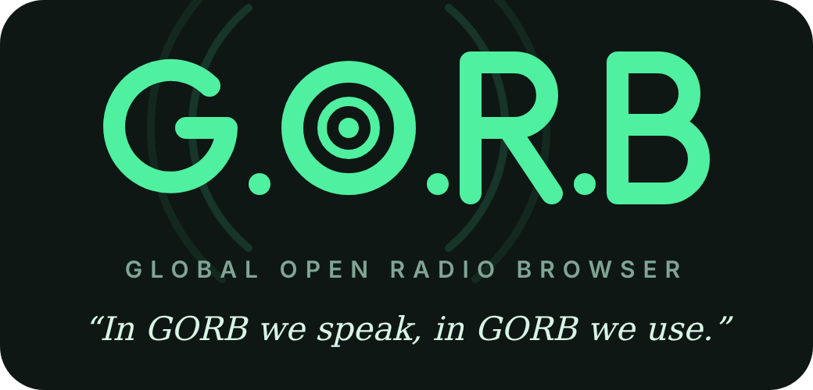

# Getting started with G.O.R.B



There are three ways to use G.O.R.B. Start with the first one: it needs
nothing but a computer.

| way | what you need | radio? |
|---|---|---|
| 1. Try it on your computer | Python | simulated |
| 2. G.O.R.B Small with a computer | Python + an ESP32 with a LoRa radio | real, license-free |
| 3. G.O.R.B Small, phone only | an ESP32 with a LoRa radio + your phone | real, license-free |

## What you need on your computer

* **Python 3.9 or newer.** Windows: get it from python.org and tick "Add
  python.exe to PATH" during install. Mac: `brew install python`, or python.org.
  Linux: it's probably already there.
* **Git**, to download G.O.R.B (or use GitHub's green "Code → Download ZIP" button).
* **ffmpeg** (only for hosting videos). Windows: `winget install ffmpeg`. Mac:
  `brew install ffmpeg`. Linux: `sudo apt install ffmpeg`.

Python pulls in everything else by itself (numpy, Pillow, pyserial).

## 1. Try it on your computer (no radio)

```bash
git clone -b claude/lucid-bohr-q586gj https://github.com/beepbeep-dev/Gorb.git
```

```bash
cd Gorb
```

```bash
pip install -e ".[small]"
```

```bash
gorb demo
```

Open http://127.0.0.1:8088/go?url=gorb%3A%2F%2Fwelcome.gorb in your browser.
That's a pretend radio band with three stations: a host, a relay and you.
Try `gorb://welcome.gorb/gallery.html` for pictures and video.

To host your own site in the simulation, make a folder with an `index.html`
in it and run these in two terminals:

```bash
gorb host --callsign HOST-1 --site mysite.gorb=./my-folder
```

```bash
gorb browse --callsign ME-1
```

## 2. and 3. G.O.R.B Small: real radios, no license

### What to buy

Each station needs **an ESP32 plus a LoRa radio chip (SX1276 or SX1262)**.
The easiest option is a board that has both built in:

| buy this | about | notes |
|---|---|---|
| **Heltec WiFi LoRa 32 V3** (915 MHz) | $20-30 | easiest; on Amazon, often as a 2-pack |
| **LilyGo T3 LoRa32** (915 MHz, v1.6.1) | $20-30 | on Amazon |
| **LilyGo T-Beam** (SX1276, 915 MHz) | $35-45 | has a battery holder, great as a relay |

**Already have an ESP32?** Add a radio module wired to it:

| module | where | notes |
|---|---|---|
| **Adafruit RFM95W LoRa Radio Breakout, 900 MHz** (product 3072) | adafruit.com, DigiKey, Mouser, sometimes Amazon | easiest to wire, labelled pins |
| **HopeRF RFM95W 915 MHz** | AliExpress, eBay | cheap, but tiny pads: needs a breakout board or careful soldering |
| **Ai-Thinker Ra-01H** (SX1276, 868/915 MHz) | Amazon, AliExpress | also tiny pads |

Searching Amazon for "RFM95W" often comes up empty. Search **"SX1276 915MHz
LoRa module"** or **"Heltec LoRa 32 V3"** instead.

Watch out for:
* **Ra-02 / SX1278 modules**: those are 433 MHz. In the US that's a ham band,
  so they won't work with the US915 preset.
* **UART LoRa modules** (REYAX RYLR998, Ebyte E32/E220): these hide the radio
  behind AT commands, and the G.O.R.B firmware can't drive them.
* Buy the **frequency for your country**: 915 MHz in the US, Canada and Australia,
  868 MHz in Europe and India.
* Get an **antenna** for the module (915 MHz, with a u.FL or SMA connector). A
  straight 8.2 cm wire soldered to the antenna pin also works. **Never power the
  radio without an antenna.**

To actually load pages you need two stations in range of each other: one
hosting and one browsing. A third one on a battery makes a relay.

### Wiring an RFM95W to an ESP32 dev board

| ESP32 pin | RFM95W pin |
|---|---|
| 3V3 | VIN / 3.3V |
| GND | GND |
| GPIO 18 | SCK |
| GPIO 19 | MISO |
| GPIO 23 | MOSI |
| GPIO 5 | CS / NSS |
| GPIO 14 | RST |
| GPIO 2 | G0 / DIO0 |
| GPIO 4 | G1 / DIO1 |

### Flashing the firmware

**No-install way (Chrome or Edge on a computer):**

1. Plug the ESP32 in with a USB **data** cable (some cables only charge).
2. Open the official Espressif web flasher: https://espressif.github.io/esptool-js/
3. Click **Connect** and pick the board's port.
4. Add the file from `firmware/gorb-small/prebuilt/` that matches your board,
   set the address to **0x0**, then click **Program**.
   * plain ESP32 dev board (+ RFM95W): `gorb-small-esp32dev.bin`
   * Heltec V3: `gorb-small-heltec_v3.bin`
   * LilyGo T3: `gorb-small-lilygo_t3.bin`
   * LilyGo T-Beam: `gorb-small-tbeam.bin`
5. Press the board's reset button (RST / EN).

**PlatformIO way** (if you want to change the code):

```bash
pip install platformio
```

```bash
cd firmware/gorb-small
```

```bash
pio run -e esp32_rfm95 -t upload
```

### Testing an ESP32 with no radio module yet

Flash the plain ESP32 file. Everything except the radio works:

1. On your phone, join the Wi-Fi **GORB-xxxx** (password `gorbradio`).
2. Open http://192.168.4.1.
3. In **My site**, pick a domain like `test.gorb` and write a page. Add a photo
   with **Add a picture**; your phone shrinks it before uploading.
4. Type `gorb://test.gorb` in the address bar. Your own site opens straight
   from the board.

Settings will say "radio off" until a module is connected. That's expected.

### Using it

* **Phone only:** join the board's Wi-Fi, open http://192.168.4.1, choose your
  region in Settings, and browse.
* **With a computer:** plug the board in and run:

```bash
gorb browse --small US915 --device COM3 --callsign my-station
```

Use the port your board shows up as: `COM3`-style on Windows,
`/dev/cu.usbserial-…` or `/dev/cu.usbmodem…` on a Mac, `/dev/ttyUSB0` or
`/dev/ttyACM0` on Linux.

## Troubleshooting

| problem | try |
|---|---|
| `gorb: command not found` | `python -m gorb ...` instead of `gorb ...` |
| the board's port doesn't show up | another USB cable (data, not charge-only); on Windows install the CP210x or CH340 driver |
| "no answer from the ESP32" | close any other program using the port (Arduino IDE, serial monitor) |
| pages never arrive | both stations on the same region? antennas on? try them a few metres apart first |
