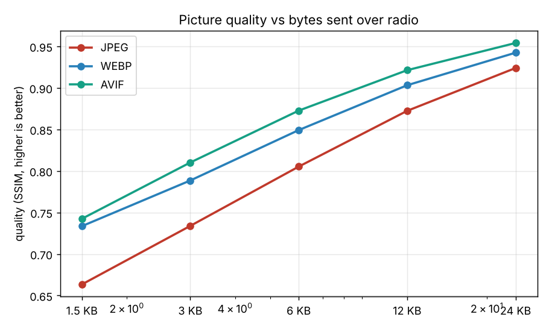
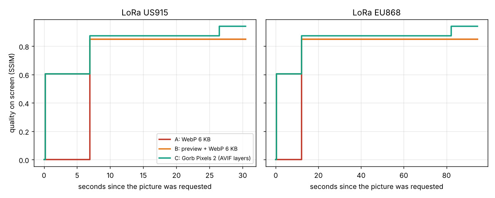

# Gorb Lab

Simulations behind how G.O.R.B sends pictures and video. Over radio, **bytes
are time**: on G.O.R.B Small (US915) about 1.2 KB a second, much less in
Europe once the 10% duty cycle kicks in, and about 0.1 KB a second on ham
G.O.R.B. So every experiment asks: for the same number of bytes, what looks best?

Quality is measured with **SSIM** (1.0 = identical to the original, 0.9 = good,
0.8 = clearly soft, under 0.7 = mush), at the size things are shown on screen.

```bash
python lab/gorb_lab.py all
```

That reruns everything (about 20 minutes). It needs `pip install scikit-image
matplotlib` and ffmpeg. Results land in `lab/results/`.

## 1. Pictures: AVIF beats WebP beats JPEG



| bytes | JPEG | WebP (v1) | AVIF |
|---|---|---|---|
| 3 KB | 0.734 | 0.789 | 0.810 |
| 6 KB | 0.805 | 0.849 | **0.873** |
| 24 KB | 0.924 | 0.942 | **0.954** |

AVIF needs about 23% fewer bytes than WebP for the same look. The same cat at
6 KB in each format:


**What this changed:** pictures are now AVIF, or WebP when the host measures
WebP looking better for that particular picture. The bigger lesson: at 24 KB
pictures score 0.95, nearly the original. Blurriness is about bytes, so the
fix is getting more bytes to you without making you wait. That's experiment 2.

## 2. Showing pictures while they arrive



On US915:

| strategy | what you see |
|---|---|
| A: one 6 KB WebP (v1 without preview) | nothing for 7 s, then 0.85 |
| B: preview + 6 KB WebP (v1) | blur at 0.2 s, 0.85 at 7 s |
| C: **Gorb Pixels 2** layers | blur at 0.2 s, 0.87 at 7 s, **0.94 at 27 s** |

**What this changed:** pictures come in three layers (preview → standard → HD).
The browser stacks them so the best one that has arrived is always on show, and
hosts send small replies first.

## 3. Video: real video with sound beats a silent slideshow

A 12-second narrated clip, measured at 30 frames a second (so choppy clips
score lower, as they look to a viewer):

| bytes | Motion v1 (silent WebP) | **Motion 2 (AV1 + Opus)** | H.264 + AAC | VP9 + Opus |
|---|---|---|---|---|
| 16 KB | 0.726, 1 fps | **0.866**, 12 fps, sound (first 6 s) | 0.752 (first 5 s) | |
| 32 KB | 0.750, 1 fps | **0.879**, 12 fps, sound | 0.777 | 0.858 |
| 48 KB | 0.789, 2 fps | **0.914**, 12 fps, sound | 0.854 | 0.891 |

Samples at 32 KB are in `results/` (`3-video-*`). Listen to the AV1 one: the
voice is clear at 6 kbps.

**What this changed:** videos are AV1 + Opus in WebM, with H.264 + AAC as a
fallback for browsers without AV1, and a smaller H.264 "lite" version for ESP32
boards. Below about 14 kbps the picture turns to mush, so long videos are cut
(to about 20 s at the default 40 KB) instead of being made blurrier.

## 4. Gorb Echo: radio is a broadcast, so share it

Five neighbours open the same ~103 KB page (two pictures with all layers and a
video), one relay hop from the host:

| | radio time used | wait for neighbours 2-5 |
|---|---|---|
| no Echo (US915) | 19.5 min | 234 s each |
| Echo, neighbours on the air at the time | 3.9 min | **instant** |
| Echo, neighbours turn up later | 11.7 min | 117 s each |

Every station keeps the replies it overhears, even ones meant for someone else.
If a neighbour loaded it, you get it instantly. If you turn up later, the relay
answers from its copy instead of passing the request back to the host. A popular
page costs about one download per neighbourhood instead of one per person.

The honest limit: in Europe (EU868), the 10% duty cycle makes a page this heavy
take many minutes the first time. European hosts should send lighter media,
for example `--hd-budget 0 --motion-budget 16000`.
