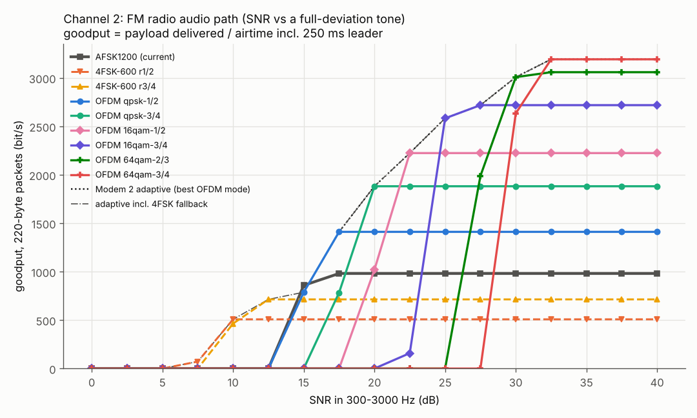

# Gorb Modem 2: can we beat AFSK1200 on an FM radio?

**Short answer: yes.**
* About **3× faster per packet on a good FM link** (2.6–3.3× at 25–40 dB).
* About **4× faster** if several packets share one key-up.
* **7–13× faster when the link has short dropouts.**

That is less than the 5–10× we hoped for on a clean link, for three understood reasons: the 250 ms key-up leader, the narrow 300–3000 Hz audio band, and the FM radio's peak limiter, which hurts OFDM. On **weak** FM links the new OFDM modem is no better than AFSK1200. A slow 4-FSK mode with error correction is what keeps working there.

**Where the numbers come from:**
* Every number is from `modem_lab.py`: 49,200 simulated frames, 120 frames per point, 513 s on 4 cores.
* The full tables are in [`results/summary.md`](results/summary.md) and the raw data in `results/results.json`.

```
python lab/radio/modem/modem_lab.py          # full run, ~9 min
python lab/radio/modem/modem_lab.py --quick  # ~25 s
python lab/radio/modem/gorb_modem2.py        # self-test
```

## 1. What was tested

A "G.O.R.B packet" here is **220 bytes**: a 180-byte DATA chunk plus about 40 bytes of header. Every transmission starts with a **250 ms leader**, as AFSK does today. **Goodput** means payload bits that arrived intact, divided by total airtime including the leader.

| modem | what it is | airtime per 220-byte packet |
|---|---|---|
| **AFSK1200 (current)** | `gorb/modem.py`, unchanged; no error correction | 1.79 s |
| **4FSK-600 r1/2, r3/4** | 4 tones, K=7 convolutional code with soft Viterbi decoding, interleaver, clock tracking | 3.46 s / 2.46 s |
| **OFDM (Gorb Modem 2)** | 53 carriers from 422 to 2859 Hz, QPSK/16QAM/64QAM, K=7 code at rate 1/2, 2/3 or 3/4, interleaver, pilots, CRC32; six modes | 0.55 s (64QAM-3/4) to 1.25 s (QPSK-1/2) |

## 2. Channels (48 kHz audio)

1. **Clean audio + noise:** noise added in the 300–3000 Hz band.
2. **FM voice radio:** models the whole path through two FM transceivers.
   * The first 100 ms are lost to key-up.
   * Pre-emphasis, then a **hard deviation limiter**, then a splatter filter.
   * De-emphasis with the wrong time constant (about 4 dB of tilt).
   * A 300–3000 Hz band-pass.
   * An 80 ppm clock offset between the two sound cards.
   * SNR is measured against a full-deviation tone, as for real FM.
3. **FM + dropouts:** channel 2 plus about one dropout per second, each 5–30 ms, filled with a noise burst ("picket fencing").

What the SNR numbers mean on a real radio: a fully quieted FM signal is about 35–45 dB on channel 2's scale. A scratchy but readable one is about 10–20 dB.

## 3. Results

### FM radio path (channel 2): the realistic case

Goodput in bit/s:

| modem | 10 dB | 15 dB | 20 dB | 25 dB | 30 dB | 35 dB |
|---|---|---|---|---|---|---|
| AFSK1200 (current) | 0 | 859 | 981 | 981 | 981 | 981 |
| 4FSK-600 r1/2 | **508** | 508 | 508 | 508 | 508 | 508 |
| **Modem 2, best OFDM mode** | 0 | 788 (0.9×) | **1882 (1.9×)** | **2583 (2.6×)** | **3008 (3.1×)** | **3192 (3.3×)** |



**The FM limiter costs OFDM about 8–10 dB.** OFDM's peaks are about 10 dB above its average, so its average level has to be kept lower than AFSK's. At low SNR that cancels out the gain from error correction.

### Clean audio + noise (channel 1)

| | 5 dB | 10 dB | 15 dB | 20 dB | 30 dB |
|---|---|---|---|---|---|
| AFSK1200 | 0 | 981 | 981 | 981 | 981 |
| **Modem 2, best mode** | **1399** | **2224 (2.3×)** | **2719 (2.8×)** | **3192 (3.3×)** | **3192 (3.3×)** |

The most robust OFDM mode, QPSK-1/2, is 1.4× faster than AFSK and works with 5 dB less signal.

### FM + dropouts (channel 3)

| | 20 dB | 25 dB | 30 dB | 35 dB |
|---|---|---|---|---|
| AFSK1200 | 213 (78% lost) | 262 | 204 | 213 |
| 4FSK r1/2 | 483 (5% lost) | 479 | 487 | 479 |
| **Modem 2, best mode** | **1599 (7.5×)** | **2113 (8.1×)** | **2422 (11.8×)** | **2779 (13.1×)** |

One dropout anywhere ruins a whole AFSK frame. Modem 2 copes in three ways:
1. It interleaves, spreading each frame's bits across all its symbols.
2. It detects which symbols a dropout hit.
3. It marks those bits as "unknown", and the error correction fills them in.

### Robustness

* **Sound-card level matters for the fast modes.** QPSK, AFSK and 4FSK work at any level from −9 to +6 dB. 16QAM-3/4 needs to be within −3 to +3 dB, and 64QAM-2/3 within 0 to +3 dB. A level-setting procedure is needed.
* **The current AFSK1200 fails at 500 ppm clock offset** (it works at 300 ppm). It has no clock recovery, so over a 1.8 s frame it slips a bit. Cheap USB sound cards can be this far off. **This is worth fixing whatever happens with Modem 2.** OFDM and 4FSK are fine at 500 ppm.
* **None of the 49,200 frames was ever delivered with wrong content.**

### The leader is the biggest overhead

These are calculated from measured error rates, not simulated:

| | 1 packet per key-up (measured) | 8 packets per key-up |
|---|---|---|
| AFSK1200 | 981 | 1116 |
| OFDM 64QAM-2/3 | 3008 | **4249 (3.8× AFSK)** |

**Sending several packets per key-up is the cheapest big win for Gorb, whichever modem it uses.**

## 4. Recommendation

**Adopt Gorb Modem 2 as an optional, negotiated fast mode.** Keep AFSK1200 as the default that every station understands.

1. Choose the OFDM mode from the SNR the other station reports, with a few dB of margin: about 18 dB → QPSK-3/4, 22 → 16QAM-1/2, 25 → 16QAM-3/4, 30 → 64QAM-2/3.
2. Add **4-FSK + FEC as the weak-link mode.** Weak links are where users get nothing today.
3. **Send several packets per key-up** (+30–40%).
4. **Shorten the leader** where radios allow it. 100 ms instead of 250 ms takes a 64QAM-2/3 packet from 0.58 s to 0.43 s.
5. **Fix AFSK1200's missing clock recovery.**

**Before trusting this, test on real radios:**
1. A sound-card loopback cable.
2. Two FM radios into dummy loads with a step attenuator: sweep the RF level, through both the mic/speaker jacks and the data port.
3. A level-setting test tone.
4. Record the received audio as WAV and replay it through the lab to calibrate the models.
5. Measure key-up times, and try a mobile station.
6. Compare against VARA FM.
7. Still to build: a streaming receiver, SNR feedback in the protocol, and multi-packet bursts in `node.py`.

## 5. Caveats

* These are models. Real radios add AGC, compressors, CTCSS tones, other filter phase responses and FM threshold clicks.
* Mobile fading is modelled only as dropouts.
* The SNR scales are the model's own scales and need calibrating against real S-meter readings.
* An FER of 0 means "probably below 2.5%".
* The modem was tuned on these same channel models.

## 6. Files

| file | what |
|---|---|
| `modem_lab.py` | The experiment: channels, AFSK wrapper, 4-FSK modem, Monte-Carlo runs (`--quick`, `--plot`) |
| `gorb_modem2.py` | **Gorb Modem 2**: `modulate(bytes, mode)`, `demodulate(audio)`, `airtime()`, `bitrate()`, self-test |
| `modem_plots.py` | Charts |
| `results/` | `results.json`, `summary.md`, PNG charts |
