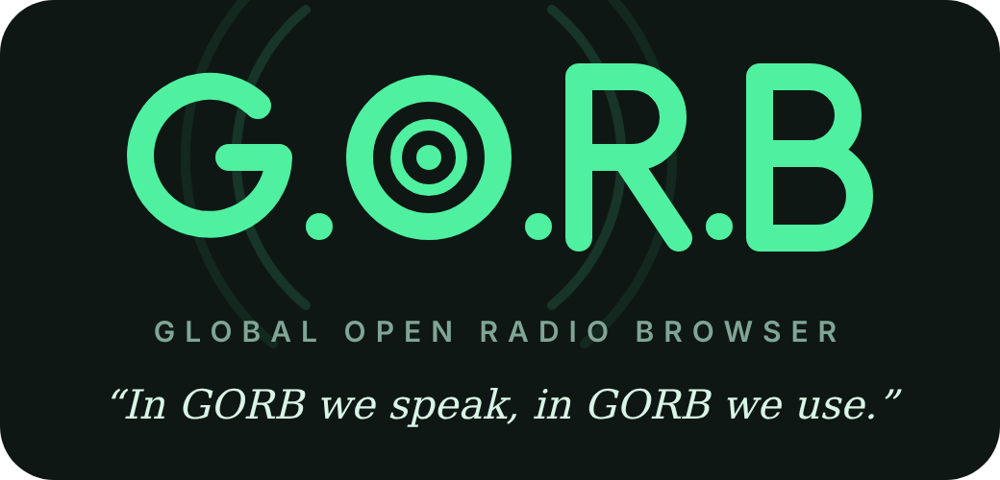

G.O.R.B (global open radio browser) in gorb we speak in gorb we use 
what is gorb gorb is a alternative to the www where instead of Wi-Fi we use radio frequency’s and broadcast signals of web browser
the bigger users using gorb the better 
limitations: slow, need a radio receiver and if you want your own domain radio sender, buggy , in beta
rules:
1 no use if gorb should be used for not safe for work content, violent content, or anything that is made for adults 
2. if you use gorb you help you need a radio sender to help send signals closer and broadcast these signals to them so if we find a website host
is as close to you we use your radio sender if the person requesting thr site is far away to send it to another person or them to help make this faster 
3. the golden rule: treat others the way you want to be treated
4. we accept vibecoded sites 
5. no signal jammers 
failure to follow these rules will make it so you can’t use gorb 


Ai use:
we use ai as I’m too lazy to sit down for 12 hours learn radio frequencies and how they work and all that 


---

<p align="center"></p>

**New here? Read [Getting started](docs/GETTING-STARTED.md):** what you need,
what to buy, and how to test an ESP32 even without a radio module.

# Using G.O.R.B (v0.1 beta)

G.O.R.B sends web pages as **sound**. A page is compressed, split into small
packets, and each packet is turned into 1200 Hz / 2200 Hz tones (the same
"AFSK 1200" sound that old-school packet radio and APRS use). Any radio that
can transmit audio can carry it, and any radio that can hear it can turn it
back into a page.

```
your browser ──GET──▶ tones ──▶ radio ~~~~~ radio ──▶ relay ~~~~~ radio ──▶ host
             ◀──page chunks── tones ◀── ...  (missing chunks are asked for again)
```

## Install

```bash
pip install -e .
```

For a real radio, add the sound card support:

```bash
pip install -e ".[radio]"
```

## Try it with no radio (simulated band)

```bash
gorb demo
```

Then open http://127.0.0.1:8088/go?url=gorb%3A%2F%2Fwelcome.gorb.
The demo puts three pretend stations in a line: a host, a relay and you.
You are too far from the host to hear it, so every page reaches you through
the relay (rule 2 in action). Add `--realtime` to feel the real 1200 baud speed.

You can also run each station as its own program. They all share the
simulated band on your computer:

```bash
gorb host --callsign HOST-1 --site cats.gorb=./my-cat-site --pos 0,0
```

```bash
gorb relay --callsign RELAY-1 --pos 8,0
```

```bash
gorb browse --callsign ME-1 --pos 16,0
```

## Use a real ham radio (needs a license)

Wire the computer's sound card **output → radio mic input** and the radio's
**speaker → sound card input** (a USB radio interface like a Digirig or
SignaLink makes this easy). Then add `--radio`:

```bash
gorb --list-devices
```

```bash
gorb browse --radio --callsign YOURCALL --input-device 1 --output-device 1
```

```bash
gorb host --radio --callsign YOURCALL --site mysite.gorb=./site --ptt /dev/ttyUSB0
```

The transmitter is keyed by the radio's VOX, or by `--ptt PORT` (RTS/DTR on a
serial port, as most USB interfaces expect).

**Be legal.** On amateur (ham) bands you need a license, your `--callsign` must
be your real callsign, and you must ID your station (G.O.R.B beacons your
callsign every 10 minutes by default). Ham rules also forbid encryption, so
G.O.R.B pages are never encrypted. Licence-free radios (FRS/PMR446 etc.) often
don't allow data at all. Check the rules where you live.

# G.O.R.B Small (license-free, ESP32 + LoRa)

Ham G.O.R.B needs a radio license. **G.O.R.B Small** doesn't: it runs on
cheap ESP32 boards with a LoRa radio chip (about $20, like a Heltec WiFi LoRa 32
or a LilyGo T3), on ISM bands anyone may use as long as they keep to the
power and airtime limits.

* About 6 to 12 kbit/s, much faster than ham G.O.R.B at 1200 baud. A small
  page loads in a few seconds.
* Range is from hundreds of metres in a city to several km with line of sight.
* **One board is enough.** It makes its own Wi-Fi hotspot, so you browse
  and host from your phone with no computer. It also relays for others (rule 2),
  and can be the radio for a computer over USB.
* G.O.R.B Small and ham G.O.R.B are separate networks that can't hear each other.

```bash
pip install -e ".[small]"
```

```bash
gorb regions
```

```bash
gorb browse --small EU868 --device /dev/ttyUSB0 --callsign my-station
```

| region | frequency | limits |
|---|---|---|
| EU868 | 869.525 MHz | 500 mW, 10% duty cycle |
| EU433 | 433.875 MHz | 10 mW, 10% duty cycle |
| US915 | 915.0 MHz | 1 W (US/Canada) |
| AU915 | 917.0 MHz | 1 W (Australia/NZ) |
| IN865 | 866.0 MHz | 1 W (India) |

Flashing, supported boards and wiring: see [firmware/gorb-small](firmware/gorb-small/README.md).
These presets are a starting point, not legal advice. Check your country's rules.

# Pictures and video: Gorb Pixels 2, Gorb Motion 2 and Gorb Echo

Radio is slow, so G.O.R.B never sends the original file. How it sends pictures
and video was decided by simulations in [the Gorb Lab](lab/README.md):

* **Gorb Pixels 2 (pictures)** come in three layers: a ~150-byte blurred
  preview straight away, a 6 KB standard picture a few seconds later, then a
  sharp 24 KB HD one. Pictures are AVIF (or WebP when that measures better for a
  given picture), which needs about 23% fewer bytes than WebP for the same look.
* **Gorb Motion 2 (video)** is real video with sound: AV1 + Opus, about 40 KB,
  12 frames a second, with H.264 as a fallback for browsers without AV1. In the
  lab it scored 0.88 against 0.75 for the old silent slideshow, at the same size.
* **Gorb Echo**: radio is a broadcast, so every station keeps the pages and
  pictures it overhears. If a neighbour already loaded something, you get it
  instantly, and relays answer from their copy instead of asking the host again.

Site makers don't do anything special: use normal `` and
`<video src="clip.mp4">` tags. Hosts can change the sizes with
`--image-budget`, `--hd-budget` and `--motion-budget`. On ham radio or in Europe
(EU868), use lighter settings such as `--hd-budget 0 --motion-budget 16000`.

```bash
gorb shrink photo.jpg photo.avif
```

That shrinks a file by hand, the same way a host would (video: `clip.webm` or
`clip.mp4`). Video needs `ffmpeg` installed.

On an ESP32 board, **My site → Add a picture** shrinks photos on your phone
before uploading, and the board's browser plays videos (as small H.264 clips).

Rule 1 note: the content filter only reads text. Nobody checks pictures
automatically, so hosts are responsible for what they post.

## Commands

| command | what it does |
|---|---|
| `gorb browse` | browser window at http://127.0.0.1:8088 |
| `gorb host --site DOMAIN=FOLDER` | host a site (domains end in `.gorb`) |
| `gorb relay` | only relay signals for others |
| `gorb get gorb://site.gorb/page.html` | print a page in the terminal |
| `gorb encode page.html out.wav` | turn a page into a sound file you can play into any radio |
| `gorb decode in.wav` | turn a recording (e.g. from an SDR) back into the page |
| `gorb demo` | host + relay + browser on the simulated band |
| `gorb shrink in.jpg out.avif` | squeeze a picture or video for radio, the way hosts do |
| `gorb regions` | list G.O.R.B Small license-free band presets |
| `gorb esp32 --device PORT --small REGION` | set up an ESP32 board (e.g. as a standalone relay) |
| `gorb --rules` | print the rules |

## How the rules are built in

1. **No NSFW/violent/adult content**: hosts refuse to send pages that trip the
   content filter and browsers refuse to show them (`gorb/rules.py`). This is a
   simple word filter, not real moderation.
2. **Everyone helps**: every station relays packets it hears that aren't for it
   (up to `--ttl` hops). It waits a random moment first and stays quiet if other
   relays already repeated the packet.
3. **Golden rule**: stations listen before talking, back off while someone else
   transmits, and can't use more than half the airtime.
4. **Vibecoded sites welcome**: anything that is HTML works.
5. **No jammers**: G.O.R.B only ever transmits real packets.

## Limits (it's a beta)

* Slow: about 100 bytes per second at 1200 baud. Keep pages small; the
  max is 64 KB after compression. Pictures and video are shrunk to fit (see above).
* Pages are shown with scripts turned off and no internet access.
* Links to other `gorb://` sites and relative links work; `http(s)` links open
  on the normal web.

## Code map

| file | job |
|---|---|
| `gorb/modem.py` | bytes ⇄ audio tones (AFSK modem, sync, CRC) |
| `gorb/packet.py` | the packet format |
| `gorb/transport.py` | real radio via sound card, or the simulated band |
| `gorb/node.py` | hosting, fetching, chunking, retries, relaying |
| `gorb/browser.py` | the browser window |
| `gorb/rules.py` | the rules and the content filter |
| `gorb/small.py` | G.O.R.B Small: regions and the ESP32 serial link |
| `gorb/media.py` | Gorb Pixels 2 and Gorb Motion 2 encoders |
| `gorb/branding.py`, `assets/` | the logo |
| `lab/` | the Gorb Lab simulations behind the media formats |
| `docs/GETTING-STARTED.md` | what you need, what to buy, how to set up |
| `firmware/gorb-small/` | ESP32 LoRa firmware |

Tests: `python -m unittest discover tests`
